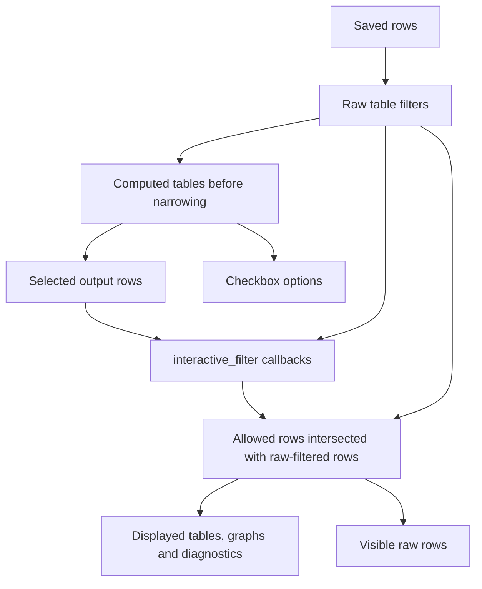

# eval-live

eval-live is an opinionated way to run paper evaluations. A paper evaluation
should be a single Python script that generates all the figures, LaTeX macros,
tables, and other artifacts the paper needs. With no arguments, that script
runs the entire evaluation. Command-line arguments change parameters or select
subsets of the work.

All command-line arguments, including their defaults, belong with the data so
that results can be reproduced. All evaluation data should be stored as flat
tables in a single output file, with one row per observation and explicit
columns identifying the commit and configuration.

The workflow starts with a list of figures, tables, and macros. Each
artifact declares the data it needs: perhaps one commit and configuration, or
several for a comparison. eval-live determines the required benchmark runs,
reuses cached results identified by commit and command-line configuration,
collects missing data, and generates the paper artifacts and an interactive
webpage from the same definitions.

Use one `Registry` for benchmarks, figures, tables, and macros. Register
callbacks directly or with decorators such as `@reg.graph("Runtime")`.
`requires=` selects treatments for an output before collection; omitting it
selects the entire catalog. `interactive_filter=` propagates browser selections
through already collected data, including selections based on computed values.
Call `reg.run()` to collect, cache, and render:

```python
def error_rows(treatment, status):
    return {"measurements": [{"suite": treatment["suite"], "size": treatment["size"],
                              "seconds": None, "status": status}]}

reg = eval_live.Registry()
reg.benchmark("worker", collect, version="1", error_rows=error_rows, inputs=["worker.py"],
              treatments=[{"suite": suite, "size": size}
                          for suite in suites for size in sizes])
reg.graph("Runtime", runtime,
          requires=lambda ts: [t for t in ts if t["suite"] in {"a", "b"}])
reg.table("Summary", summary)  # no selector: all declared treatments
reg.macros("Paper numbers", numbers)
reg.run(args=args, argv=tokens)
```

Selectors are ordinary Python functions. Their results are combined and
deduplicated before collection. Requested treatments without `commit` use
`--commit` (HEAD by default). For a comparison, a selector can return copies
of a treatment with different `commit` values. The resolved commit is saved
as provenance; labels such as “baseline” belong in the figure.
Repetitions are ordinary treatment fields
such as `sample`; callbacks compute averages or other statistics. CLI
measurement parameters—including a script's total sample count—and the
declared data `version` participate in cache identity and are saved with results.

Treatments run sequentially by default. Mark a treatment with `parallel=True`
to allow separate worker processes; `--jobs N` caps concurrency (default: CPU
count). Unmarked treatments run alone. The flag and worker limit are included
in the saved configuration and cache key. JSON writes remain serialized.

See the [Python guide](docs/python-guide.rst) for writing an evaluation and
the [data format](docs/data-format.rst) for inspecting saved results.

## Demo and Python documentation

The [top-level demo](demo/README.md) is a small, runnable paper evaluation using
the full evaluation API, including comparisons across two local Git commits:

```bash
pip install -e '.[render]'
python demo/eval.py
```

Open `demo/out/paper/index.html` for the interactive report. Its Python graphs and
computed tables load Pyodide and matplotlib from a CDN; raw tables work without
that runtime. The demo writes all data to `demo/out/paper/results.json` and
paper artifacts alongside it. Run it again to reuse cached observations;
`--samples 5` changes the demo's configuration, `--only summary` selects a subset, and
`--dry-run` explains required work without running it. `--render-only` regenerates
outputs from saved sample selections without the benchmark repository.
Timeouts are disabled by default; `--timeout 60` opts into a per-command limit.
Increasing it reuses successes and recollects timed-out treatments. Repeating
the same deadline reuses timeout rows; ordinary error rows are reused until
`--force` requests fresh collection.

**Row invariant:** every requested treatment has rows in every table declared
by `error_rows` before collection starts. The callback supplies rows for
pending, timed-out, failed, and interrupted work; successful results replace
the placeholders. Timeout and failure statuses remain distinct. Ctrl+C stops
the whole evaluation, including parallel workers, while preserving those rows.
Temporary worktrees are removed after workers stop, including on Ctrl+C.

Treatment timeouts and failures are ordinary data. Figures decide whether to
emit `eval_live.warn(...)` or `eval_live.error(...)`. These messages are computed
rendering outputs, never stored in the database. The CLI shows each unique
message as it occurs, then summarizes all warnings followed by all errors.
The webpage shows derived warning/error tables that update with filtering.
Reporting errors fail the CLI after other outputs are evaluated; warnings do not.
Generated files are published only after successful rendering. A failed or
interrupted invocation removes generated outputs while preserving saved data.

Only measurement data is cached. Figures, tables, macros, and the webpage are
regenerated on each run. Browser filter changes recompute the report and publish
its tables and graphs together. Each output directory holds one report; use
separate directories to retain different subsets or comparisons. The HTML embeds
all runs referenced by those outputs, including cached runs and other commits,
with their configurations and diagnostics. Unrelated history stays in `results.json`.

Reliable statistics still depend on the evaluation script: declare all
measurement inputs, count timeouts and failures, join comparisons by treatment
keys, and keep rendering callbacks deterministic. The [Python guide's advice on
misleading results](docs/python-guide.rst#avoid-misleading-results) explains these
risks, measurement units, and the browser's integer limits.

The [Python documentation](docs/index.rst) includes a tutorial, data and filter
contracts, and API reference generated from docstrings. Build it locally with:

```bash
pip install -e '.[docs]'
python -m sphinx -W --keep-going -b html docs docs/_build/html
```

Then open `docs/_build/html/index.html`.

## Install

```bash
pip install git+https://github.com/oflatt/eval-live.git
```

Or for local development:

```bash
pip install -e /path/to/eval-live
```

## Python API

The package bundles JS, CSS, and a Pyodide helper library. Access them as strings
for embedding into a self-contained HTML page:

```python
import eval_live

eval_live.css()          # CSS stylesheet
eval_live.js()           # JavaScript library (defines initEvalLive)
eval_live.pyodide_lib()  # eval_live.py source for Pyodide runtime
```

## JavaScript API

The JS library exposes a single entry point:

```js
initEvalLive(container, data, name, graphScript, evalLivePy, extraModules)
```

- **container**: DOM element or element ID
- **data**: `{ tableName: [rowObjects] }` dict
- **name**: project name shown in the heading
- **graphScript** (optional): Python script that builds an `eval_live.Registry`
- **evalLivePy** (optional): source of the `eval_live.py` library (from `eval_live.pyodide_lib()`)
- **extraModules** (optional): `{filename: source}` mapping for additional Python modules

## Graphs and computed tables

Define graphs and tables in a Python script using the `Registry` API:

```python
import eval_live

reg = eval_live.Registry()
reg.graph("My Graph", my_graph_fn)
reg.table("Summary", summary_fn, interactive_filter=summary_filter_fn)
eval_live.registry = reg
```

`interactive_filter(filtered_rows, data)` filters the **input data** based on
the computed **output rows** still visible after the user's filter. For example,
if a summary groups samples by algorithm and input size, the callback keeps
all input samples for the visible groups. It returns a new data dictionary,
which eval-live uses to redraw tables and figures. Saved data stays unchanged.
Without this callback, filtering a computed table changes only that table's view.

See the [Python guide](docs/python-guide.rst) and
[API reference](docs/api.rst) for graphs, tables, and filter propagation.

## Rendering to the terminal and disk

A `Registry` renders outside the browser too, from the same `data` dict and the
same table definitions, so a table looks consistent everywhere:

```python
reg.render_to_console(data)       # pretty tables in the terminal
reg.render_to_dir(data, "out/")   # graphs -> <id>.pdf, tables -> <id>.json + <id>.tex
```

`render_to_console` uses `rich` (a normal dependency) and accepts an optional
`rich.Console`. `render_to_dir` needs `matplotlib` (`pip install
eval-live[render]`). Graphs are skipped in the terminal (no image).

## Table display: captions and styled cells

Columns and headers are simply the row keys, in first-seen order — so name your
keys the way you want them to appear. The only presentation option is an
optional caption:

```python
reg.table("Timings", timings_fn, caption="Lower is better.")   # caption shown under the table
```

### Styled cells

A cell is normally a scalar. To style it, return a dict instead:

```python
{"text": "1.5x", "style": {"color": "green", "bold": True}}
{"text": "slow", "style": "red"}     # a bare string is shorthand for the color
```

`style` is **purely visual** — eval-live has no notion of "good"/"bad"; what a
style means is up to you. It is a dict with any of:

- `color` — a color (see below)
- `bold` — `true` for bold
- `dim` — `true` for dimmed/muted

or a plain string used as the `color`.

**What colors work:** the color is passed to the terminal renderer (`rich`) and,
in the browser, set as a CSS color, so use a value both understand. The basic
names — `black`, `red`, `green`, `yellow`, `blue`, `magenta`, `cyan`, `white` —
and hex such as `#1b6b35` work everywhere. The terminal additionally accepts any
[rich style](https://rich.readthedocs.io/en/stable/style.html); the browser
additionally accepts any CSS color. LaTeX dumps ignore styling and keep the text.

To pass parameters to computed tables/graphs, add an ordinary one-row table to
the data (e.g. `data["params"] = [{"threshold": 0.5}]`) and read it in your
functions. It is shown as a small raw table like any other.

## Standalone page

Open `eval_live/index.html` in a browser to load a JSON file via file picker.

## Architecture

The viewer keeps saved rows in `state.data`, controls in `state.ui`, and the
current report in `state.engine`. Saved rows stay unchanged for the lifetime of
the page. Raw tables, computed tables, and diagnostics have independent controls,
even when their display names match.

Filter edits use `updateFilters(mutator)` to update the controls and request a
calculation. `setState(mutator)` redraws the page for presentation changes and
engine results. Collapsing a table, changing highlighting, and switching graph
tabs do not recalculate the outputs.

SQL, column text, and typed checkbox selections are independent constraints:
rows must pass all three. Editing SQL leaves checkbox selections intact, and
checkboxes do not rewrite SQL. Clear all filters resets all three.

- **state.js** — the single state object plus *pure* derivations (row filtering,
  `rawFilteredData`) and reducers. No DOM, no async; unit-tested
  directly in node.
- **table-view.js** — `buildTableView` creates persistent controls. `update`
  supplies result rows and checkbox options; `sync(state)` updates the controls
  and replaces the visible rows. Focus, filters, and collapse choices survive
  result changes; row expansion is local display state.
- **graph-engine.js** — `createEngine` evaluates Python callbacks from a snapshot
  of the filters and publishes the complete report. It owns no DOM.
- **eval-live.js** — `initEvalLive`: owns the state, wires reducers, and
  `render(state)` reconciles the whole page (graph bar, raw + computed tables).

Within one calculation, filters flow in this order:



Selections and checkbox options come from tables before narrowing. Using the
displayed tables to select inputs would make a filter depend on its own results
and could make choices disappear. Each output's static `requires` selection
still limits its rendering data. A computed table without `interactive_filter`
only filters its own displayed rows.

Calculations run one at a time because they share a Python runtime. Each captures
the filters before awaiting Python; it never reads later edits during that pass.
If the filters change, the current calculation finishes and its results or errors
are discarded. The newest queued selection is then evaluated. Tables, graphs,
and diagnostics appear together only for the current selection, and computed
values are hidden while that calculation is pending or has failed. Callbacks run
again on every input change; the Python runtime remains loaded.

## Tests

Pure-JS unit + DOM-smoke tests, no npm/jsdom (they run the browser modules in a
`node:vm` context with a tiny DOM shim):

```bash
node test/state.test.mjs   # state core: filtering, reducers, typed selections
node test/dom.test.mjs      # initEvalLive end-to-end: filter / collapse / checkbox / clear
node test/graph-engine.test.mjs  # Pyodide conversion boundary: graphs / tables / narrowing
python test/test_registry.py
python -m unittest discover -s test -p 'test_*.py'
```

The AlaSQL row-evaluation path and the actual Pyodide runtime are exercised in
the browser; the engine unit test uses a small runtime stub.

CI also builds the Python docs and runs the demo with real Pyodide in Chromium.
To run that browser check locally after generating the default demo:

```bash
pip install playwright
python -m playwright install chromium
python test/browser_smoke.py
```
